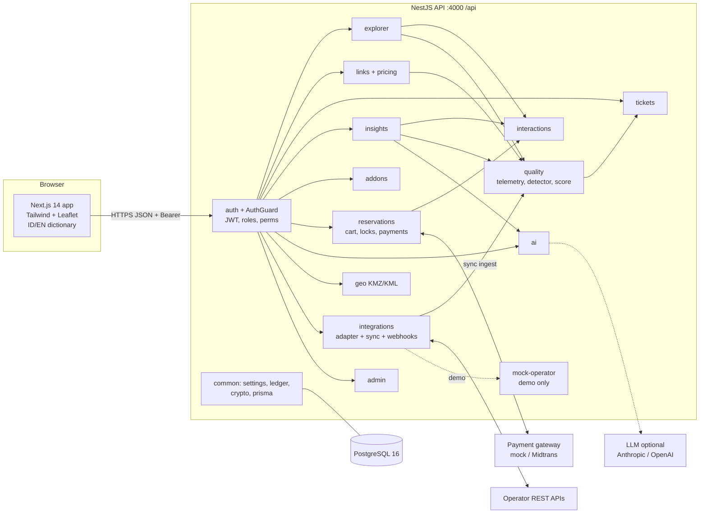
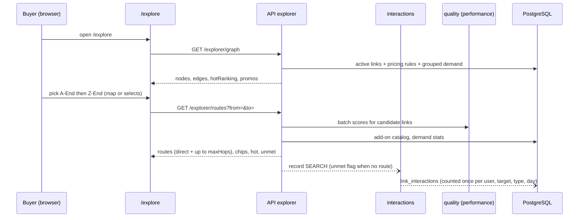
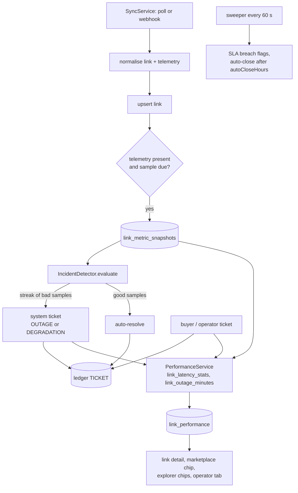
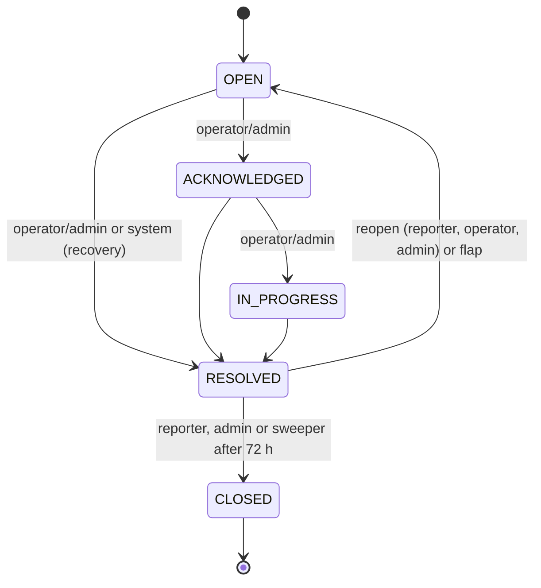
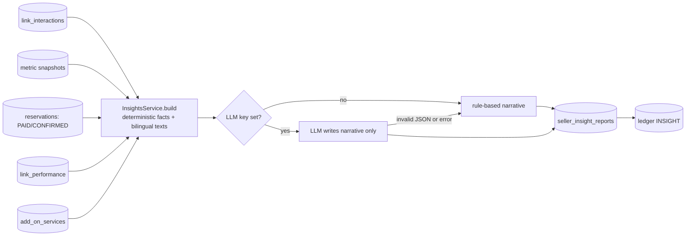
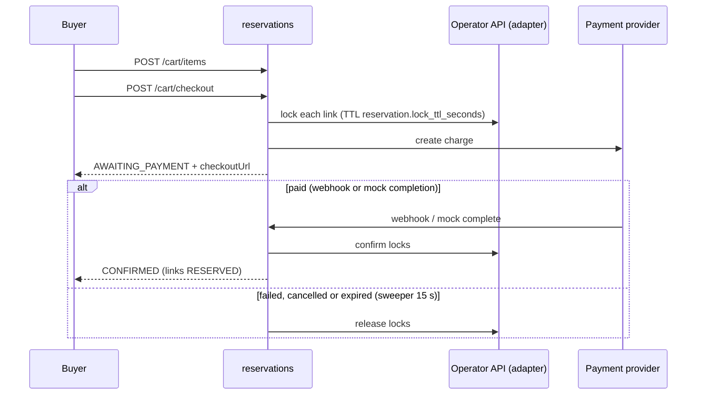
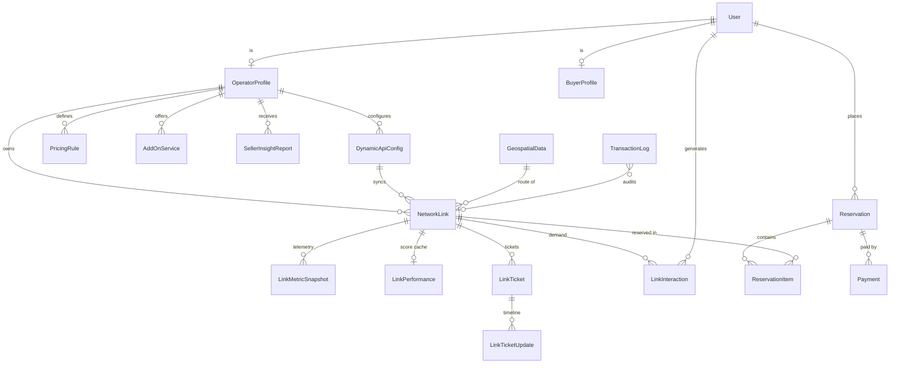

# Architecture

Modular monolith: one NestJS API (`apps/api`), one Next.js web app (`apps/web`), one PostgreSQL database. External parties (operator APIs, payment gateway, LLM) are reached only through adapters/providers. Everything described here was read from the source; see [api-reference.md](api-reference.md) for endpoints and [settings.md](settings.md) for thresholds.

## System overview

## Modules

| Module (`apps/api/src/...`) | Responsibility |
| --- | --- |
| `common` | `SettingsService` (typed reads of `platform_settings` with defaults, 15 s cache), `LedgerService` (hash-chained append-only log), `CryptoService` (AES-256-GCM for credentials), `PrismaService`, `AuthGuard` + `@Roles`/`@Perms`, `nodes.ts` (city key normalisation), `OperatorContext`. |
| `auth` | Register, login (with throttle), `/auth/me`. JWT HS256, 8 h. |
| `admin` | Overview, operator approval, users, ledger view + verification, sync runs, settings editing. |
| `integrations` | Per-operator API configs (credentials encrypted), `GenericRestAdapter` (SSRF guard, field mapping, value maps, telemetry mapping), `SyncService` (scheduler ticking every 10 s, manual sync, ingest), operator webhooks. |
| `geo` | KMZ/KML/GeoJSON upload, parse to GeoJSON (hardened against DTD and zip bombs), attach to links. |
| `links` | Marketplace search, facets, detail, quote, public stats; operator link CRUD; `PricingService` (rule engine); pricing rule CRUD. |
| `interactions` | Demand events (`link_interactions`), dedupe, throttle, hot calculation, unmet-demand lookup, retention purge. |
| `explorer` | City graph, route search (iterative deepening, bounded), promo and capability chips, hot ranking. |
| `quality` | `TelemetryService` (writes samples during sync), `IncidentDetector` (opens/escalates/reopens/auto-resolves system tickets), `PerformanceService` (score + KPIs, scheduler every 5 min), admin recompute. |
| `tickets` | State machine, SLA stamping, role/tenant scope, ledger events, KPIs, SLA/auto-close sweeper (every 60 s). |
| `insights` | Seller report builder (demand, congestion, add-ons, improvements), optional LLM narrative, history, per-link performance table. |
| `addons` | Operator add-on catalog and public read. |
| `reservations` | Cart, checkout with operator locks, payment providers (`mock`, `midtrans`), payment webhooks, expiry sweeper (every 15 s), server-side CART_ADD/RESERVE tracking. |
| `ai` | Buyer route analysis (intent parsing, deterministic ranking, optional LLM narrative) and the shared `completeJson` used by insights. |
| `mock-operator` | Two simulated operator APIs (NusaLink bearer, Garuda API key) and the incident injector. Mounted only outside production (or `ENABLE_MOCK_OPERATOR=true`). |
| `health.controller.ts` | `GET /api/health` with a DB probe. |

Web (`apps/web`): pages under `app/` (`/`, `/login`, `/register`, `/explore`, `/marketplace`, `/links/[id]`, `/ai`, `/cart`, `/reservations`, `/reservations/[id]`, `/pay/mock/[paymentId]`, `/tickets`, `/tickets/[id]`, `/operator`, `/admin`), shared components in `components/`, API client, auth context and i18n in `lib/`. All UI text comes from `lib/dictionary.ts` (ID and EN keys) or from `{id,en}` JSON in the database.

## Data flow: map explorer

Nodes are not a table: a node is the normalised city name (`trim`, lower case, collapsed spaces) of an endpoint of an active link of an approved operator. Edges aggregate all links of an undirected city pair. A route is a simple path of at most `explorer.maxHops` hops; per leg the cheapest `explorer.maxParallelPerEdge` links are candidates.

## Data flow: telemetry, tickets, performance

Ticket lifecycle:

The transition matrix is the setting `ticket.transitions`; who may do which move is fixed in `TicketsService.transition`. A partial unique index allows only one open `SYSTEM` ticket per link; a second partial unique index allows one public operator reply per ticket (both in `prisma/sql/001_constraints_indexes.sql`).

## Data flow: seller AI insights

Facts never come from the LLM. Every item carries `evidence`; sections with too little data return `{insufficient, needed, have}`. Sellers only see their own links; add-on advice exposes a renter count, not identities.

## Data flow: reservation and payment

Every step appends to the ledger (`LINK_LOCK`, `RESERVATION`, `PAYMENT`).

## Data model overview

Tables are snake_case via `@@map` (for example `network_links`, `link_tickets`, `transaction_logs`). Money is `Decimal(18,2)`. Bilingual text is `Json` `{id,en}`. Business entities are soft-deleted (`deletedAt`); `transaction_logs` and `link_ticket_updates` are append-only through triggers (`sql/003_immutability.sql`; the ticket update trigger permits deleting rows of demo tickets). Seeded fabricated rows carry `isDemo=true`.

Database objects Prisma cannot express live in `apps/api/prisma/sql/`:

| File | Content |
| --- | --- |
| `001_constraints_indexes.sql` | one open SYSTEM ticket per link, one public reply per ticket, interaction partial indexes, CHECK constraints (loss 0-100, score range, due dates, interaction target) |
| `002_link_stats.sql` | functions `link_latency_stats(...)` and `link_outage_minutes(...)` used by the performance score |
| `003_immutability.sql` | append-only triggers for `transaction_logs` and `link_ticket_updates` |

`prisma db push` is the only schema mechanism (there are no migrations), and these files must be re-applied after every push (`npm run db:sql`).

## Cross-cutting rules

- **No hardcoded business data**: prices, availability and attributes come from the database or operator APIs; thresholds from `platform_settings`; UI strings from `dictionary.ts`.
- **Evidence and honesty**: ratings need minimum samples and coverage; rates need minimum tickets; every analytic payload has a `basis` (window, includesDemo); engines are labelled `rule-based` or `llm:<model>`.
- **Tenant isolation**: scoping is part of the Prisma `where` (not a post-filter); out-of-scope rows return 404.
- **Ledger**: security- and money-relevant events are appended to a hash chain. Ticket events use `ledger.append` inside the same transaction (a failed ledger write rolls the ticket change back); most other modules use `appendSafe`, which logs and swallows a ledger failure.
- **Security hardening** (`main.ts`): security headers, JSON body limit 100 kb, optional per-IP rate limiter (default on in production), production refuses to boot with placeholder secrets, SSRF guard on operator URLs, mock operator/payments/demo seed off in production.
- **Single-instance assumption**: login throttle, rate limiter, explorer/demand caches and all `@Interval` jobs run inside the API process.
